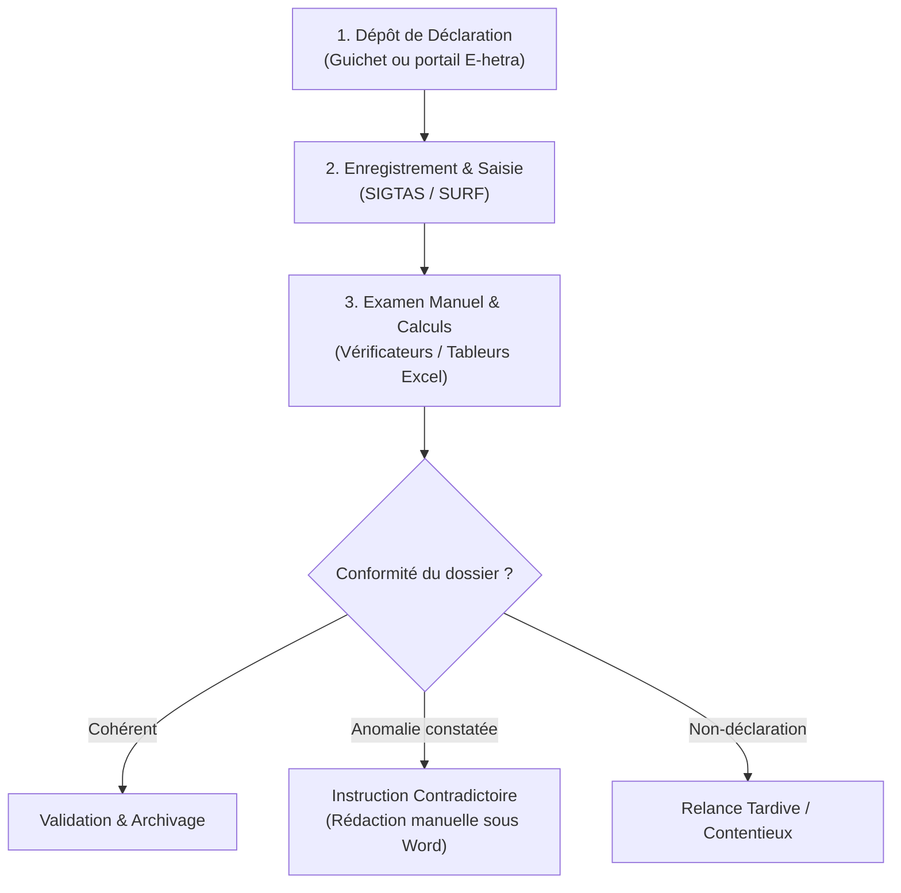

# PARTIE II : ANALYSE ET CONCEPTION

---

# CHAPITRE 4 : ANALYSE PRÉALABLE

---

## Introduction du chapitre

Toute démarche d'ingénierie logicielle débute par une analyse préalable approfondie de l'environnement existant. Cette phase conditionne la pertinence du futur système d'information : elle permet de comprendre les rouages du fonctionnement opérationnel en place, d'en cerner les points forts et les limites, et d'établir les bases de la solution à concevoir.

Au sein de la **Direction Générale des Impôts (DGI) de Madagascar**, la surveillance des obligations fiscales relatives à la Taxe sur la Valeur Ajoutée (TVA) et le traitement des défaillants représentent des enjeux stratégiques pour les recettes de l'État. 

Ce **Chapitre 4** présente :
1. **L'analyse de l'existant** (organisation actuelle, acteurs impliqués, procédures de déclaration et inventaire des moyens matériels et logiciels) ;
2. **La critique de l'existant** (diagnostic objectif des atouts et des dysfonctionnements du système actuel) ;
3. **La conception avant-projet** (formulation de solutions palliatives, choix méthodologiques et justification comparative des technologies retenues face à leurs homologues du marché).

---

## 4.1. Analyse de l'Existant

### 4.1.1. Organisation Actuelle (Traitement Actuel et Personnel Impliqué)

L'administration fiscale malgache est territorialement découpée en Directions Régionales des Impôts (DRI), comprenant la Direction des Grandes Entreprises (**DGE**), les Services Régionaux des Entreprises (**SRE**) et les **Centres Fiscaux** locaux.

#### A. Le personnel impliqué et ses attributions
L'activité fiscale quotidienne mobilise quatre profils d'acteurs aux responsabilités bien délimitées :
* **Le Contribuable (Entreprise assujettie)** : Dépose mensuellement ses déclarations de TVA et s'acquitte des droits dus auprès du Trésor public ou via les banques partenaires ;
* **L'Agent Fiscal (Guichet / Réception)** : Réceptionne les déclarations papier ou les bordereaux dématérialisés, vérifie la complétude formelle du dossier et enregistre les données déclaratives ;
* **L'Inspecteur / Contrôleur Fiscal** : Procède au recoupement des données déclarées avec les informations extérieures, analyse la cohérence des montants, engage les procédures de vérification sur pièces et notifie les redressements ;
* **Le Chef de Centre / Responsable Fiscal** : Supervise le portefeuille territorial, valide les propositions de redressement et suit les indicateurs globaux de recouvrement.

#### B. Déroulement du processus actuel de contrôle fiscal
Le circuit déclaratif et de contrôle traditionnel s'articule en quatre phases séquentielles :

1. **Déclaration périodique** : Avant le 15 de chaque mois, les entreprises souscrivent leur déclaration de TVA. Les déclarations s'effectuent soit au guichet physique sur formulaire imprimé, soit via le téléservice national (**E-hetra**) ;
2. **Saisie et archivage** : Les montants déclarés sont consolidés dans les systèmes de gestion existants de l'administration (notamment **SIGTAS** et **SURF**) ;
3. **Contrôle et vérification sur pièces** : Les agents effectuent un rapprochement manuel entre le chiffre d'affaires déclaré, les achats imputables et le montant reversé. Ce travail est complété par des recoupements sporadiques sur relevés papier (données douanières ou bancaires) ;
4. **Traitement des anomalies et relances** : En cas d'incohérence arithmétique ou de minoration présumée, l'inspecteur rédige manuellement les courriers de notification (Notification Primitive puis Définitive). De même, les lettres de mise en demeure pour défaut de déclaration sont rédigées au cas par cas.

---

### 4.1.2. Inventaire des Moyens Matériels et Logiciels

L'évaluation des ressources techniques mobilisées au sein des services fiscaux a permis d'établir l'inventaire suivant :

#### A. Moyens matériels existants
* **Postes de travail clients** : Ordinateurs de bureau (micro-ordinateurs sous Windows 7/10/11) connectés au réseau local ministériel (LAN/Intranet) ;
* **Serveurs d'infrastructure** : Serveurs physiques dédiés hébergeant les applications métier nationales ;
* **Équipements d'impression** : Imprimantes laser réseau utilisées pour la reproduction des formulaires, bordereaux de perception et notifications contradictoires.

#### B. Moyens logiciels existants

| Composant / Logiciel | Rôle opérationnel | Observations / Limites |
|---|---|---|
| **SIGTAS** (*Standard Integrated Government Tax Administration System*) | Système intégré de gestion de l'assiette et du recouvrement fiscal | Progiciel centralisé complexe, lourd d'accès pour les contrôles dynamiques au quotidien |
| **SURF** | Système unifié de recouvrement fiscal | Outil d'enregistrement des paiements |
| **Portail E-hetra** | Télé-déclaration et télé-paiement en ligne pour contribuables | Déclaratif sans moteur de calcul contradictoire instantané |
| **Bureautique (MS Excel, Word)** | Outils de calcul d'écart, vérification de déductibilité et rédaction des actes | Manipulation manuelle, dispersion des fichiers, fort risque d'erreurs |
| **Base de données Oracle / PostgreSQL** | Stockage central des répertoires d'entreprises | Requêtage direct réservé aux administrateurs informatiques |

---

## 4.2. Critique de l'Existant (Points Forts et Points Faibles)

Une analyse critique objective de ce fonctionnement traditionnel met en évidence des bases réglementaires solides mais de sérieux goulets d'étranglement opérationnels.

### 4.2.1. Points Forts de l'Existant
* **Cadre juridique et légal rigoureux** : L'administration s'appuie sur le Code Général des Impôts (CGI) malgache et le Code des Procédures Fiscales, qui définissent clairement les droits et obligations de l'assujetti ;
* **Amorce de digitalisation** : Le déploiement de la télé-déclaration (E-hetra) a habitué une partie des entreprises aux formalités en ligne ;
* **Existence d'un référentiel d'immatriculation** : Le Numéro d'Identification Fiscale (NIF) permet une identification administrative unifiée sur tout le territoire national ;
* **Expertise des inspecteurs** : Les vérificateurs possèdent une excellente maîtrise des techniques comptables et des subtilités du contentieux fiscal.

### 4.2.2. Points Faibles de l'Existant

| Domaine | Dysfonctionnements constatés | Conséquences opérationnelles |
|---|---|---|
| **Calculs et déductibilité** | Vérification arithmétique manuelle des barèmes (IS à 5% et minima IR) | Risque élevé d'erreurs humaines et temps de calcul excessif |
| **Détection du risque** | Absence de système automatique d'évaluation et de scoring | Sélection des dossiers arbitraire ou aléatoire, sentiment d'injustice fiscale |
| **Recoupement tiers** | Impossibilité de croiser instantanément les flux tiers (Douanes, banques, fournisseurs) | Fraudes par minoration de recettes ou fausses factures indétectables à temps |
| **Suivi des défaillants** | Décompte manuel des jours de retard et relances tardives | Prescription des créances fiscales et pertes substantielles de recettes publiques |
| **Procédure contradictoire** | Rédaction artisanale sous traitement de texte et saisies redondantes | Risque de vices de forme juridiques et dépassement des délais légaux de 30 jours |
| **Pilotage décisionnel** | Manque de tableaux de bord visuels en temps réel par centre fiscal | Difficulté pour la hiérarchie d'évaluer le taux d'incivisme fiscal territorial |

---

## 4.3. Conception Avant-Projet

Face aux limites diagnostiquées, l'avant-projet définit les orientations fonctionnelles et les choix méthodologiques pour doter la DGI d'un outil d'aide à la décision moderne : le projet **SSIF (Système de Pilotage et de Suivi du Contrôle Fiscal)**.

### 4.3.1. Proposition des Solutions

Pour pallier l'ensemble des défaillances constatées, la solution proposée repose sur cinq axes majeurs :

1. **Automatisation intégrale des calculs légaux** :  
   Intégration native des formules de calcul de la TVA théorique selon le régime fiscal de l'entreprise (IS à 5%, barème et plancher IR de 320 000 Ar + 20% du CA), avec détection instantanée de l'écart ;
2. **Classification visuelle des risques** :  
   Système de balisage dynamique par code couleur orientant immédiatement l'inspecteur vers les anomalies significatives :
   * Vert : dossier conforme (écart < 25%) ;
   * Orange : dossier en alerte (écart de 25% à 50%) ;
   * Rouge : dossier critique exigeant un contrôle contradictoire immédiat (écart > 50%).
3. **Croisement automatisé des flux tiers** :  
   Module de rapprochement calculant un ratio de cohérence $\left(\frac{\text{CA Déclaré}}{\sum \text{Recoupements}}\right)$ pour déceler automatiquement les dissimulations de chiffre d'affaires ;
4. **Dématérialisation de la procédure contradictoire** :  
   Gestion numérique des étapes légales (Notification Primitive, gestion des prorogations de délai, imputation automatique des crédits d'impôt antérieurs validés et émission de la Notification Définitive) avec génération de documents PDF officiels conformes au Code des Procédures Fiscales ;
5. **Gestion automatisée des défaillants et relances** :  
   Identification quotidienne des entreprises n'ayant pas souscrit de déclaration à l'échéance légale et génération groupée de mises en demeure.

---

### 4.3.2. Méthodes de Conception et Outils Utilisés (Choix, Justification et Présentation)

La réussite d'un système d'information repose sur l'adoption de méthodes de modélisation éprouvées et d'une pile technologique adaptée aux exigences de l'État.

#### A. Méthode de modélisation retenue : UML (Unified Modeling Language)
* **Justification** : Le langage UML (version 2.5) est retenu comme standard pour modéliser le système sous le paradigme orienté objet. Sa notation universelle permet de formaliser sans ambiguïté les cas d'utilisation des agents, les diagrammes de séquence illustrant la chronologie des règles fiscales et le diagramme de classes qui préfigure la structure de la base de données (Chapitres 5 et 6).

---

#### B. Choix Majeurs des Technologies et Analyse Comparative avec leurs Homologues

Pour garantir la pérennité, la sécurité et la haute réactivité du système SSIF, chaque choix technologique majeur a fait l'objet d'une étude comparative approfondie face aux solutions homologues du marché.

---

### 1. Framework Frontend : React 19 vs Angular et Vue.js

| Critères d'évaluation | ⚛️ React 19 (Retenu) | 🅰️ Angular | 🟢 Vue.js |
|---|---|---|---|
| **Architecture** | Bibliothèque par composants réactifs | Framework d'entreprise complet | Framework progressif |
| **Courbe d'apprentissage** | Modérée, syntaxe JSX déclarative | Abrupte (TypeScript forcé, RxJS, injection de dépendances) | Douce |
| **Performance d'exécution** | Optimale via Virtual DOM et React Server Components | Élevée mais bundle initial volumineux | Élevée |
| **Flexibilité & Écosystème** | Immense écosystème modulaire (Tailwind, Axios, Vite) | Écosystème rigide et monolithique | Bon écosystème |
| **Adéquation au projet** | **Excellente** : idéal pour construire une SPA rapide avec des formulaires complexes de simulation TVA. | Trop lourd pour l'envergure du projet. | Intéressant mais écosystème d'outils fiscaux/PDF plus restreint. |

> **Conclusion du choix** : **React 19** a été choisi pour sa souplesse, son rendu ultra-rapide des composants dynamiques (badges de risque en temps réel) et son découplage parfait avec l'API backend.

---

### 2. Moteur Backend : Node.js (Express 5) vs Django (Python) et Spring Boot (Java)

| Critères d'évaluation | 🟢 Node.js / Express 5 (Retenu) | 🐍 Django (Python) | ☕ Spring Boot (Java) |
|---|---|---|---|
| **Modèle d'exécution** | Asynchrone, non bloquant (Event-Loop) | Synchrone par défaut (WSGI/ASGI) | Multi-threading lourd |
| **Unité linguistique** | **JavaScript unique (Full-Stack)** | Python | Java |
| **Consommation mémoire** | Très faible (~50 à 100 Mo RAM) | Moyenne | Élevée (> 300 Mo RAM au démarrage) |
| **Rapidité de mise en œuvre** | Immédiate, minimaliste | Rapide (ORM intégré) | Lente et verbeuse |
| **Débit I/O (Requêtes/sec)** | Très élevé pour les flux de données déclaratives | Moyen | Élevé |
| **Adéquation au projet** | **Idéale** : un seul langage (JavaScript) partagé entre client et serveur, déploiement léger. | Excellent pour la Data Science mais verbeux pour une API REST pure. | Surdimensionné, temps de compilation et maintenance trop lourds. |

> **Conclusion du choix** : **Node.js avec Express 5** a été retenu pour sa rapidité de traitement des requêtes concurrentes, sa faible empreinte mémoire et l'avantage d'une pile JavaScript full-stack homogène.

---

### 3. Système de Base de Données : PostgreSQL vs MySQL et MongoDB

| Critères d'évaluation | 🐘 PostgreSQL 14+ (Retenu) | 🐬 MySQL | 🍃 MongoDB |
|---|---|---|---|
| **Modèle de données** | Relationnel objet (SGBDR) | Relationnel pur (SGBDR) | Document NoSQL (BSON) |
| **Conformité ACID** | **Stricte et sans compromis** | Dépend du moteur (InnoDB) | Éventuelle (BASE), ACID limité |
| **Gestion des calculs financiers** | Type `DECIMAL / NUMERIC` ultra-précis | Type `DECIMAL` supporté | Risque d'arrondis en virgule flottante |
| **Traitement JSON hybride** | Support natif avancé (`JSONB` indexé) | Support basique | Natif |
| **Intégrité référentielle** | Clés étrangères strictes, triggers puissants | Bon support des FK | Pas de contraintes d'intégrité strictes |
| **Adéquation au projet** | **Parfaite** : indispensabilité légale de l'intégrité financière et des relations strictes entre déclarations, NIFs et relances. | Convient mais gestion JSON et types personnalisés moins avancés. | **Inadapté** pour un système fiscal exigeant des transactions financières fiables. |

> **Conclusion du choix** : **PostgreSQL** s'est imposé comme une évidence en raison de sa conformité absolue aux standards financiers ACID et de son support des données géographiques et institutionnelles (`unitefiscal.json`).

---

### 4. Mappage Objet-Relationnel : Prisma ORM vs Sequelize et TypeORM

| Critères d'évaluation | 💎 Prisma ORM 6 (Retenu) | 📦 Sequelize | 🛡️ TypeORM |
|---|---|---|---|
| **Approche de modélisation** | Déclarative dans `schema.prisma` | Définition par code JavaScript | Décorateurs TypeScript |
| **Sécurité contre les injections** | Requêtes 100% paramétrées par défaut | Risques potentiels sur requêtes brutes | Bon mais verbeux |
| **Typage et auto-complétion** | Génération automatique d'un client typé | Typage partiel et complexe | Bon typage |
| **Migrations de schéma** | Versionnage fluide (`prisma migrate`) | Complexe, migrations manuelles | Parfois instable en production |
| **Outil de visualisation** | **Prisma Studio intégré** (GUI web) | Aucun outil officiel | Aucun outil officiel |
| **Adéquation au projet** | **Excellente** : schéma clair, lisible, élimination des erreurs de frappe SQL et studio visuel pour auditer la base. | Ancien, syntaxe désuète. | Trop dépendant de TypeScript et complexe à configurer. |

> **Conclusion du choix** : **Prisma ORM** offre la meilleure garantie d'intégrité du code, une productivité accrue et une sécurité native totale contre les failles d'injection SQL.

---

### 5. Conception Graphique : Tailwind CSS 4 vs Bootstrap 5

| Critères d'évaluation | 🎨 Tailwind CSS 4 (Retenu) | 🅱️ Bootstrap 5 |
|---|---|---|
| **Philosophie** | Classes utilitaires atomiques | Composants préconçus |
| **Personnalisation** | Totale, aucune limite de design | Difficile, risque d'aspect générique "Bootstrap" |
| **Poids du bundle final** | Minimal (moteur de purge JIT ne conservant que les classes utilisées) | Plus lourd (classes inutilisées souvent embarquées) |
| **Adaptabilité responsive** | Mobile-first natif avec préfixes (`sm:`, `md:`, `lg:`) | Système de grille traditionnel à 12 colonnes |
| **Adéquation au projet** | **Idéale** : design sur-mesure aux couleurs institutionnelles de la République de Madagascar. | Trop générique pour un portail ministériel moderne. |

> **Conclusion du choix** : **Tailwind CSS 4** permet d'obtenir une interface sur-mesure, légère et ergonomique, parfaitement adaptée aux écrans des inspecteurs fiscaux.

---

### 6. Sécurité de Session : Cookie `httpOnly` + JWT vs Sessions Serveur Traditionnelles (Express-Session / Redis)

| Critères d'évaluation | 🔐 JWT en Cookie `httpOnly` (Retenu) | 💾 Session classique (Stateful en mémoire / Redis) |
|---|---|---|
| **Stockage d'état** | **Stateless** (aucun stockage mémoire sur le serveur) | **Stateful** (consomme de la RAM sur le serveur pour chaque agent) |
| **Scalabilité horizontale** | Immédiate (l'API peut être répliquée sur plusieurs serveurs sans partage de session) | Complexe (nécessite un serveur Redis dédié pour partager les sessions) |
| **Résistance aux attaques XSS** | **Totale** : le flag `httpOnly` rend le token invisible pour JavaScript | Totale si le cookie de session est aussi `httpOnly` |
| **Résistance aux attaques CSRF** | Assurée par l'attribut `SameSite=Lax` | Nécessite un jeton anti-CSRF |
| **Adéquation au projet** | **Optimale** : simplifie le déploiement sur serveur d'application tout en garantissant une étanchéité de session de 8 heures. | Plus lourd à maintenir en environnement de production restreint. |

> **Conclusion du choix** : L'utilisation de **JWT encapsulé dans un cookie `httpOnly`** allie la légèreté de l'authentification sans état (stateless) à la sécurité maximale contre le vol de session.

---

## Conclusion du chapitre

L'**Analyse préalable** a mis en lumière l'inadéquation des méthodes manuelles actuelles face à l'accroissement du nombre de contribuables à Madagascar. La dispersion des données, la lenteur des vérifications et le manque d'automatisation privent l'administration de recettes fiscales substantielles.

En réponse, la plateforme **SSIF** apporte une solution complète combinant calcul automatisé des barèmes de TVA, scoring objectif du risque, rapprochement des flux tiers et dématérialisation des notifications. 

L'étude comparative des technologies confirme la pertinence de la pile retenue :
* **React 19** pour la fluidité et la réactivité de l'interface ;
* **Node.js (Express 5)** pour l'agilité et l'unification full-stack ;
* **PostgreSQL 14+ et Prisma ORM** pour la rigueur transactionnelle et la sécurité des données financières ;
* **Tailwind CSS 4** et **JWT en cookie `httpOnly`** pour l'ergonomie et la défense en profondeur.

Fondé sur le langage de modélisation **UML**, ce projet dispose d'un cadre méthodologique et technique rigoureux. Cette étape préalable permet d'aborder avec sérénité la phase d'**Analyse conceptuelle (Chapitre 5)**.

